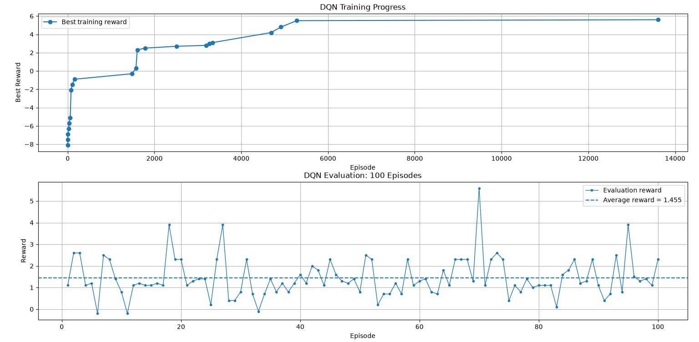

# Flappy Bird result artifacts

This directory contains the published outputs from the local Flappy Bird DQN training and evaluation run.

## Published files

- [`flappybirdv0_evaluation.csv`](flappybirdv0_evaluation.csv) — per-episode rewards from 100 greedy evaluation episodes.
- [`flappybirdv0.log`](flappybirdv0.log) — best-reward training progress log.
- [`Figure_1.png`](Figure_1.png) — experiment visualization.
- [`fig 2.png`](fig%202.png) — experiment visualization.

## Visualizations

## Recorded evaluation summary

- Evaluation episodes: 100
- Mean reward: 1.455
- Population standard deviation: 0.907
- Maximum reward: 5.6
- Minimum reward: -0.2

The model checkpoint (`.pt`) remains local and is not included in this directory. See [Experiment Results](../EXPERIMENT_RESULTS.md) for the evaluation protocol, interpretation, and limitations.
